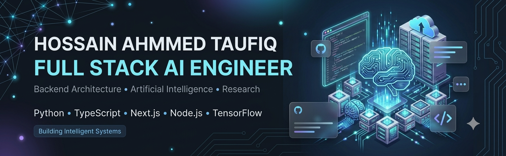

<!-- HERO BANNER -->
<div align="center">



</div>

<br/>

---

## `$ whoami`

```ts
const taufiq = {
  name        : "Hossain Ahmmed Taufiq",
  role        : "Full-Stack Engineer · Backend & AI/ML Systems",
  location    : "Dhaka, Bangladesh 🇧🇩",
  companies   : ["Justkaaj (Founder & CEO)", "Softlligence (Founder & tech Lead)"],
  education   : "B.Sc. CSE — North South University  |  CGPA 3.83 / 4.00  |  Dec 2026",
  research    : [
    "Epilepsy Detection via EEG + Deep Learning      →  journal submission",
    "Multimodal RAG with Hallucination Reduction     →  conference submission",
    "Multi-Task ML for Materials Science             →  Published ✓",
  ],
  currentFocus: "Scaling Justkaaj · Publishing research · LLM-integrated systems",
  funFact     : "Running two companies & publishing research papers simultaneously 🤯",
};
```

> 3+ years shipping production systems — from a live service marketplace (500+ users, investor-pitched) to LLM-integrated backends and peer-reviewed deep-learning research. Building at the intersection of **engineering**, **AI**, and **entrepreneurship**.

<br/>

---

## 💻 Tech Stack

<div align="center">

### 💡 Languages

<p>
  
</p>

### 🎨 Frontend

<p>
  
</p>

### ⚙️ Backend

<p>
  
</p>

### 🗄️ Database

<p>
  
</p>

### 🤖 AI & Machine Learning

<p>
  
</p>

<p>
  
  
  
  
</p>

### ☁️ Cloud & DevOps

<p>
  
</p>

</div>


## 💼 Professional Experience

---

### Founder & CEO · Softlligence Technologies
**Jan 2026 – Present · Dhaka, Bangladesh**

Building enterprise-grade software, AI-powered products, and digital solutions for businesses across multiple industries.

- Architect software architectures and lead end-to-end product development from planning to deployment.
- Develop scalable web applications using **Next.js, Node.js, Express, TypeScript, PostgreSQL, and MongoDB**.
- Design AI-powered solutions leveraging **LLMs, RAG systems, LangChain, and Gemini API** integrations.
- Lead client communication, technical decisions, code reviews, and product strategy across multiple projects.

<br>

### Software Engineer · ZERODEVS LTD
**Jan 2025 – May 2026 · On-site**

- Engineered production-ready SaaS applications using **Next.js, Express.js, Node.js, TypeScript, and MySQL**.
- Developed and maintained the official **SHORBORNO School ERP**, serving **100+ educational institutions** across Bangladesh.
- Built scalable REST APIs, authentication systems, and backend services while improving application performance and maintainability.
- Collaborated closely with cross-functional teams to deliver business-critical software features.

<br>

### Full-Stack Developer · Brooksource
**Apr 2023 – Sep 2024 · Remote (US)**

- Developed enterprise React applications using **React.js, TypeScript, Redux, and REST APIs**.
- Reduced application load time by **20%** through code splitting, lazy loading, and performance optimization.
- Designed scalable frontend architecture and API integration layers for distributed enterprise systems.
- Delivered production features across Agile teams spanning multiple time zones.

---

---

## 🚀 Featured Projects

### AI CRM Platform
> **Next.js • Express • MongoDB • Gemini 2.5 • Kotlin**

AI-powered CRM ecosystem across Web, Android, and Telegram with intelligent automation, conversational workflows, and real-time synchronization.

---

### SHORBORNO School ERP
> **Next.js • TypeScript • Express • MySQL**

Enterprise SaaS platform serving **100+ educational institutions**, featuring scalable architecture, responsive UI, and secure backend services.

---

### Playpen School Platform
> **Next.js • PostgreSQL • AWS**

Production-ready school management system supporting online admissions, tuition payments, events, and parent engagement.

---

### FocusFlow
> **Python • PySide6 • Matplotlib**

Offline desktop productivity suite integrating task management, habit tracking, calendar scheduling, analytics, and local-first data storage.

---

## 📊 GitHub Analytics

<div align="center">


<br><br>


<br><br>


</div>
---

## 🎓 Education

<br/>

<div align="center">

| 🏛️ Institution | Degree | Score | Year |
|:---:|--------|:-----:|:----:|
| **North South University, Dhaka** | B.Sc. Computer Science & Engineering | **CGPA 3.83 / 4.00** | `Expected Dec 2025` |
| **Notre Dame College, Dhaka** | HSC — Science | **GPA 5.00 / 5.00** | `Jan 2020` |

</div>

<br/>

*Relevant coursework:* DSA · Machine Learning · AI · Software Engineering · Database Systems · Web Development

<br/>

---

## 📜 Certifications

<br/>

<div align="center">

<table>
<tr>
<td align="center"></td>
<td align="center"></td>
</tr>
<tr>
<td align="center"></td>
<td align="center"></td>
</tr>
<tr>
<td align="center" colspan="2"></td>
</tr>
</table>

</div>

<br/>

---

## 🤝 Let's Connect

<br/>

<div align="center">

*If you're building something ambitious in **backend systems**, **AI/ML infrastructure**, or **product engineering** — let's talk.*

<br/>

<table>
<tr>
<td align="center">
<a href="https://www.linkedin.com/in/hossaintaufiq/">
  
</a>
</td>
<td align="center">
<a href="mailto:hossainahmmedtaufiq22@gmail.com">
  
</a>
</td>
<td align="center">
<a href="https://github.com/hossaintaufiq">
  
</a>
</td>
</tr>
</table>

<br/>


</div>
